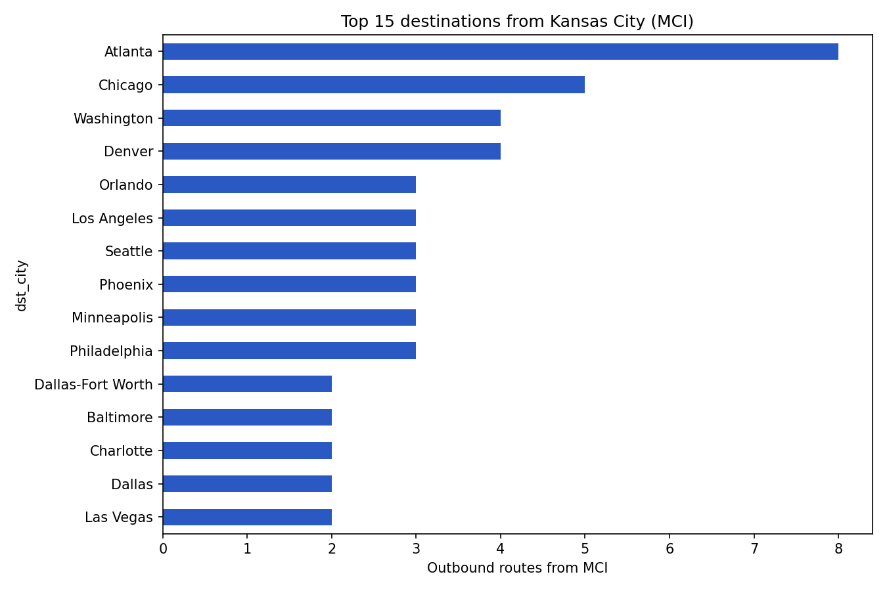
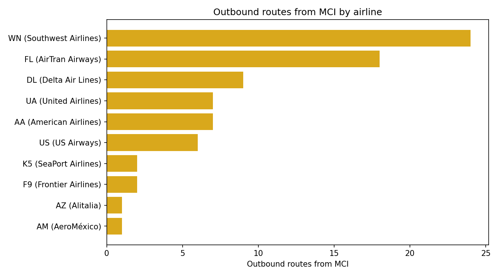
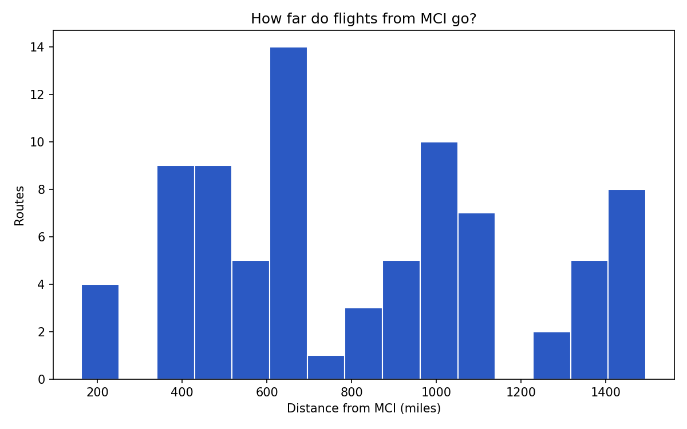
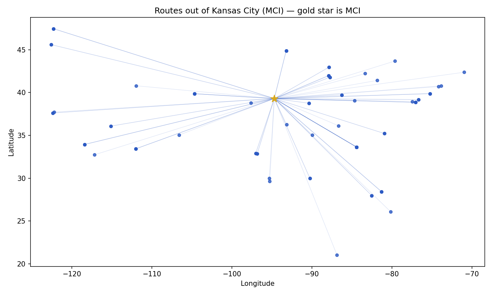

# Flight Patterns from Kansas City (MCI) — Exploratory Data Analysis

An exploratory analysis of the flight routes in and out of Kansas City
International Airport (MCI), built from public route data.

Why this airport: I worked as a ramp operator at the airport for a few months & was curious. I already knew some of the plane schedules from the ground side and I wanted to test my understanding with data.

## What I found

All numbers below were computed from the data in this repo by
`eda_mci.py`. 

- **82 outbound routes from MCI, to 43 unique destinations, flown by
  15 airlines.** Inbound routes: 77.
- **97.6% domestic.** 80 of 82 outbound routes stay in the United
  States; 2 are international.
- **All 82 outbound routes are nonstop** in this dataset (0 stops).
- **Distance:** median 704 miles, mean 826 miles. Longest route in the
  set is MCI–San Francisco, 1,495 miles. Shortest is MCI–Salina, Kansas,
  162 miles.
- **Busiest destinations by route count:** Atlanta (8 routes),
  Chicago (5), Denver (4), Washington (4), then Seattle, Minneapolis,
  Phoenix, Philadelphia, Orlando, and Los Angeles (3 each).
- **Busiest airlines from MCI:** Southwest (WN, 24 routes), AirTran
  (FL, 18), Delta (DL, 9), American (AA, 7), United (UA, 7),
  US Airways (US, 6).

## Charts






## Data and methods

- **Source:** OpenFlights airports, routes, and airlines data
  (`data/airports.dat`, `data/routes.dat`, `data/airlines.dat`),
  public data from the OpenFlights project.
- **Tools:** Python (pandas, matplotlib) for cleaning and visuals;
  SQLite for the SQL queries in `sql/mci_queries.sql` — the same
  questions answered in SQL and in Python, so the two can be checked
  against each other.
- **Distance:** great-circle (haversine) distance from MCI's
  coordinates (39.2976, -94.7139) to each destination airport.

## Honest caveats

- The OpenFlights route data is **historical, not today's schedule**.
  That is why defunct/merged carriers appear: AirTran (FL) was folded
  into Southwest, and US Airways (US) into American. Treat the
  findings as a picture of the route network in that dataset, not as
  a 2026 timetable. MCI today serves about 47 nonstop destinations;
  this dataset lists 43.
- Route count is not flight frequency. Atlanta having 8 routes means
  8 airline/route listings to Atlanta, not 8 flights a day.
- This is a route-network EDA, not a delay analysis. Delays need
  time-series data.

## Next step (Phase 2)

Add delay and on-time performance using the U.S. Bureau of
Transportation Statistics (BTS) Airline On-Time Performance data,
filtered to MCI. That is a much larger download (one month at a time
from TranStats), so it is a separate step, not part of this first
finished project.

## How to reproduce

```bash
python3 eda_mci.py
sqlite3 mci_flights.sqlite < sql/mci_queries.sql
```

`eda_mci.py` rebuilds `mci_outbound_routes.csv`, `FINDINGS.txt`,
`mci_flights.sqlite`, and the four charts in `charts/`.
